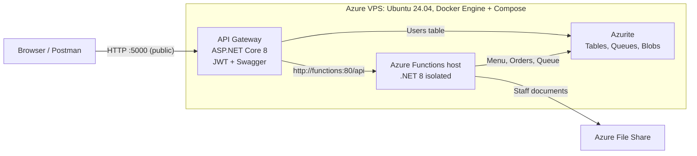
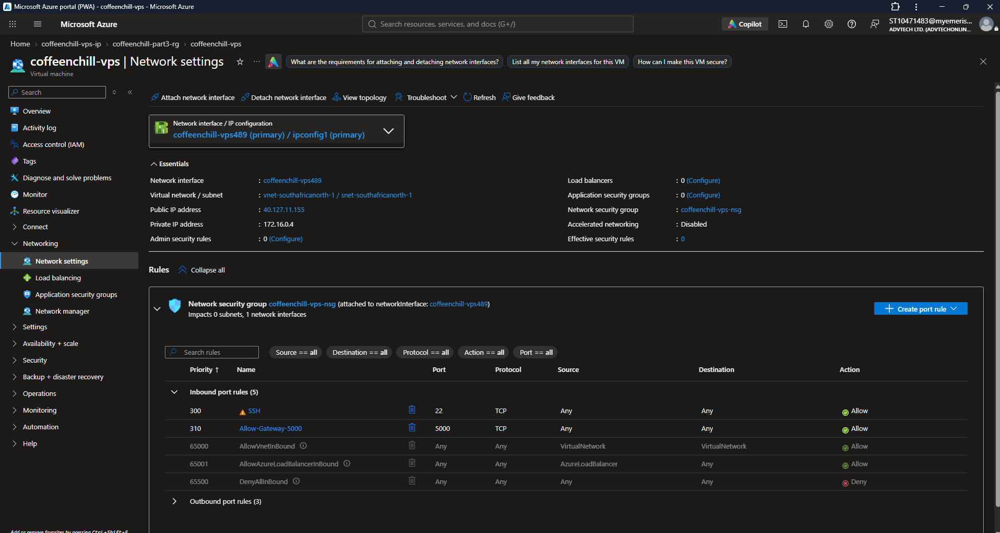
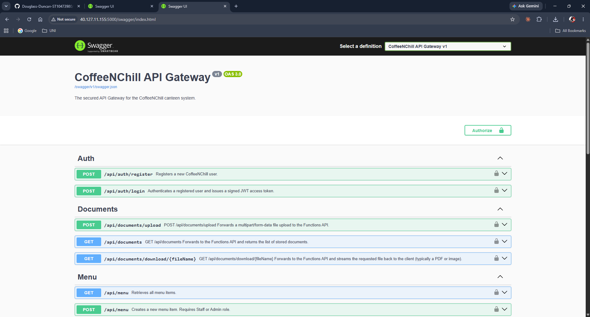
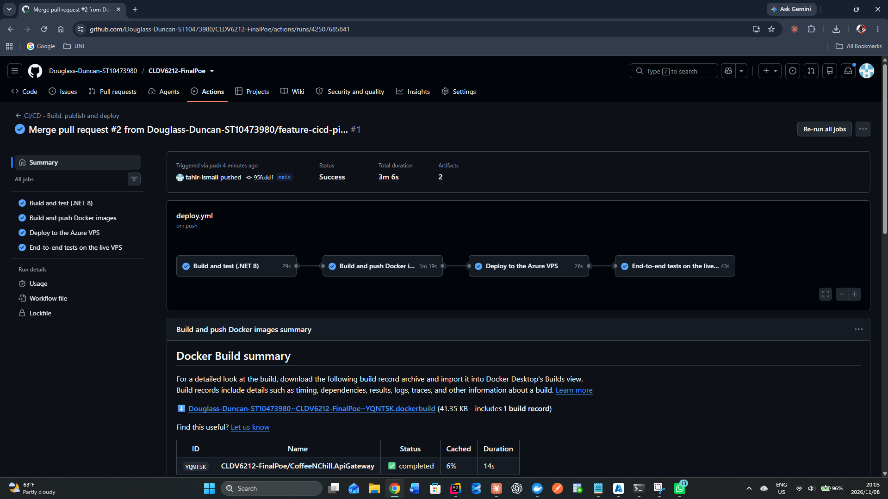
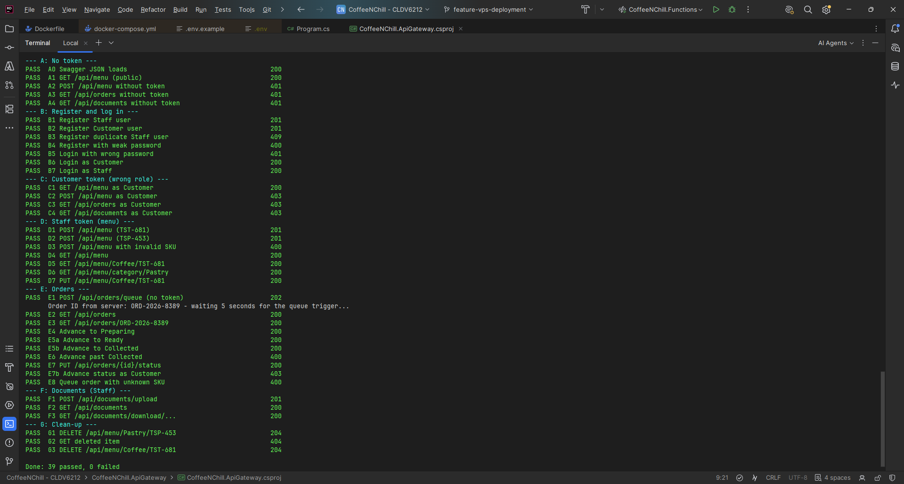
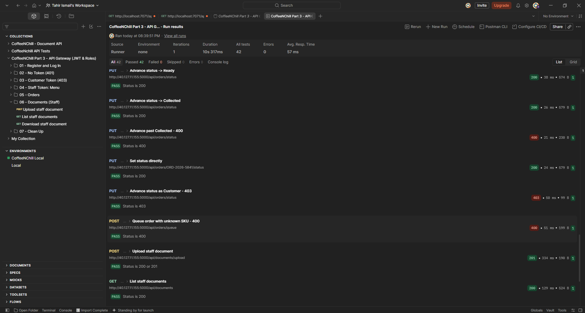

# CoffeeNChill Canteen Management System — CLDV6212 POE

## Overview

This repository contains the CoffeeNChill cloud project, built in three parts for the CLDV6212 Portfolio of Evidence:

- **Part 1:** Azure Functions + Azure Table Storage + Azure File Share (Menu API, Document API)
- **Part 2:** Azure Storage Queue + Queue-Triggered Functions (Order Processing)
- **Part 3:** ASP.NET Core API Gateway + JWT Authentication + VPS Deployment

## Repository Structure

| Folder | Description |
|--------|-------------|
| `CoffeeNChill.Functions/` | Azure Functions project (Parts 1 & 2) |
| `CoffeeNChill.ApiGateway/` | ASP.NET Core API Gateway (Part 3) |
| `docs/postman/` | Postman collections for testing |
| `docker-compose.yml` | Docker orchestration (Azurite + Functions + Gateway) |

## Running Locally

### Prerequisites
- .NET 8 SDK
- Azurite (or Docker)
- Azure Functions Core Tools

### Steps
1. Start Azurite:
azurite


2. Start the Functions host:
cd CoffeeNChill.Functions
func start

3. Start the API Gateway:
cd CoffeeNChill.ApiGateway
dotnet run


4. Open Swagger:
http://localhost:5000/swagger


## Live Deployment (VPS)

- **Live Swagger UI:** http://40.127.11.155:5000/swagger
- **Deployment:** Docker Compose on an Azure Ubuntu VPS, redeployed automatically by GitHub Actions on every push to `main`
- Full details: see **Part 3 — Docker, VPS Deployment & CI/CD (Role 3)** below~~~~

## Video Walkthrough

[YouTube link to be added once the final video is recorded]

---

## Part 1 — Menu API & Document API

Built with Azure Functions (.NET 8 Isolated) and Azure Table Storage / File Share. See `CoffeeNChill.Functions/Functions/MenuFunctions.cs` and `DocumentFunctions.cs`.

## Part 2 — Order Queue Processing

Orders are placed on the `order-processing-queue`. A queue-triggered function (`ProcessOrderQueue`) reads each message, saves it to the `Orders` table with status "Received", and manages the full lifecycle: **Received → Preparing → Ready → Collected**. Poison-queue handling ensures failed messages are logged.

## Part 3 — API Gateway (Role 1)

**Author:** Neha Heeralal — ST10478910

### What It Does

The `CoffeeNChill.ApiGateway` is an ASP.NET Core Web API that sits in front of the Azure Functions and exposes a clean REST API to clients. It **forwards** every request to the appropriate backend endpoint and returns the response — so clients only need to know about the gateway, not the underlying services.

### Architecture

| File | Purpose |
|------|---------|
| `Program.cs` | Configures DI, HttpClient, Swagger, and global exception middleware |
| `Controllers/MenuController.cs` | Forwards menu CRUD requests (GET/POST/PUT/DELETE) |
| `Controllers/OrdersController.cs` | Forwards order queue, listing, and status endpoints |
| `Controllers/DocumentsController.cs` | Forwards document upload, list, and download |
| `Middleware/GlobalExceptionHandlingMiddleware.cs` | Catches all unhandled exceptions and returns clean JSON errors |
| `DTOs/MenuItemRequestDto.cs` | Request model for creating/updating menu items |

### Endpoints Exposed by the Gateway

| Method | Route | Forwards To |
|--------|-------|-------------|
| `GET` | `/api/health` | Functions' health check |
| `GET` | `/api/menu` | Functions' get all menu items |
| `GET` | `/api/menu/{category}/{sku}` | Functions' get single menu item |
| `GET` | `/api/categories/{category}` | Functions' get items by category |
| `POST` | `/api/menu` | Functions' create menu item |
| `PUT` | `/api/menu/{category}/{sku}` | Functions' update menu item |
| `DELETE` | `/api/menu/{category}/{sku}` | Functions' delete menu item |
| `POST` | `/api/orders/queue` | Functions' queue order (producer) |
| `GET` | `/api/orders` | Functions' get all orders |
| `GET` | `/api/orders/{orderId}` | Functions' get single order |
| `PUT` | `/api/orders/status` | Functions' advance order status |
| `PUT` | `/api/orders/{orderId}/status` | Functions' set specific order status |
| `POST` | `/api/documents/upload` | Functions' upload staff document |
| `GET` | `/api/documents` | Functions' list staff documents |
| `GET` | `/api/documents/download/{fileName}` | Functions' download staff document |

### Configuration

The Gateway reads these settings from `appsettings.json` (locally) or Docker environment variables (in the container stack):

| Key | Local Dev | Docker |
|-----|-----------|--------|
| `Functions:BaseUrl` | `http://localhost:7071/api` | `http://functions:80/api` |
| `ConnectionStrings:AzureStorage` | `UseDevelopmentStorage=true` | Azurite connection string |
| `Jwt:Key` / `Jwt:Issuer` / `Jwt:Audience` | Placeholders | From `.env` file |

### Swagger UI

The Gateway exposes interactive API documentation at:
- **Local:** `http://localhost:5000/swagger`
- **Docker/VPS:** `http://40.127.11.155:5000/swagger`

Swagger is available in **both** Development and Production (it's registered outside the `if (app.Environment.IsDevelopment())` block).

### Global Exception Handling

Every unhandled exception is caught by `GlobalExceptionHandlingMiddleware`, which:
- Logs the error with method + path
- Returns a clean JSON response: `{ "error": "...", "path": "...", "method": "...", "traceId": "..." }`
- Prevents raw stack traces from leaking to clients

### Postman Collection

A Postman collection for testing the Gateway is available at:
`docs/postman/CoffeeNChill - API Gateway.postman_collection.json`

Import it into Postman, ensure the Functions host is running (`http://localhost:7071`) and the Gateway is running (`http://localhost:5000`), then test each request.

### Docker Notes

The Gateway is containerized (see `CoffeeNChill.ApiGateway/Dockerfile` and `docker-compose.yml`). It runs on **port 5000** inside the Docker network. The Functions are accessible internally at `http://functions:80/api` — which is why `UseHttpsRedirection()` was removed (the Docker network uses plain HTTP).

---
## Part 3 — Docker, VPS Deployment & CI/CD (Role 3)

**Author:** Tahir Ismail — ST10471483

### What This Role Delivers

The whole CoffeeNChill system runs on a live Linux server in Azure, built from Docker images published on Docker Hub, and it is redeployed automatically every time code is pushed to `main`.

| Deliverable | Where |
|-------------|-------|
| Live Swagger UI (public) | **http://40.127.11.155:5000/swagger** |
| API Gateway image | [`tahirismail/coffeenchill-gateway`](https://hub.docker.com/r/tahirismail/coffeenchill-gateway) |
| Azure Functions image | [`tahirismail/coffeenchill-functions`](https://hub.docker.com/r/tahirismail/coffeenchill-functions) |
| Gateway Dockerfile | `CoffeeNChill.ApiGateway/Dockerfile` |
| Container orchestration | `docker-compose.yml` |
| Secrets template | `.env.example` |
| CI/CD pipeline | `.github/workflows/deploy.yml` |
| Automated end-to-end tests | `test-gateway.ps1` (39 checks) |

### Deployment Architecture



Only the **gateway** is reachable from the internet. Azurite and the Functions host are bound to `127.0.0.1`, so they can only be reached from the server itself. Every client request has to pass through the gateway's JWT checks, the same way every visitor to an office building has to go through reception.

### The Azure VPS

| Setting | Value |
|---------|-------|
| Provider | Microsoft Azure (Azure for Students) |
| VM name / region | `coffeenchill-vps`, South Africa North |
| Size | Standard B2als_v2 (2 vCPU, 4 GB RAM, x64) |
| Operating system | Ubuntu Server 24.04 LTS |
| Public IP | `40.127.11.155` |
| Software | Docker Engine 29, Docker Compose v5 |
| Inbound ports | 22 (SSH, for administration and deployments), 5000 (API Gateway) |
| Cost control | Auto-shutdown at 23:00 SAST; the VM is stopped when not in use |

The network security group only allows SSH (22) and the gateway port (5000). Everything else is blocked by Azure's default `DenyAllInBound` rule.



### Docker Images

Both application images are built with **multi-stage Dockerfiles**: the full .NET 8 SDK compiles and publishes the code, and only the published output is copied into a small runtime image. The final images contain no source code or build tools.

The gateway Dockerfile also:
- runs the app as the built-in **non-root `app` user**, so a compromised container has fewer permissions
- listens on port **8080** (`ASPNETCORE_HTTP_PORTS=8080`), which Compose maps to port 5000
- restores NuGet packages in a separate layer, so rebuilding after a code change is fast

Images are **version-tagged** on Docker Hub:

| Tag | Meaning |
|-----|---------|
| `v3.0` | First Part 3 release (built and pushed manually) |
| `v3.<run number>` (e.g. `v3.1`) | Built and pushed automatically by each CI/CD run |

### docker-compose.yml

One command starts all three services on a private Docker network (`coffeenchill-network`):

| Service | Image | Ports | Purpose |
|---------|-------|-------|---------|
| `azurite` | `mcr.microsoft.com/azure-storage/azurite` | `127.0.0.1:10000-10002` (local only) | Table, Queue and Blob storage |
| `functions` | `tahirismail/coffeenchill-functions:${IMAGE_TAG:-v3.0}` | `127.0.0.1:7071` (local only) | Menu, documents, order queue and status functions |
| `gateway` | `tahirismail/coffeenchill-gateway:${IMAGE_TAG:-v3.0}` | `5000` (public) | Swagger, JWT authentication, role checks, request forwarding |

Key design points:
- **Images are pulled from Docker Hub**, not built on the server.
- Containers find each other by **service name** (`http://functions:80/api`, `http://azurite:10002`), because `localhost` inside a container means the container itself.
- Azurite stores its data in the named volume **`azurite-data`**, so users, menu items and orders survive restarts.
- `restart: unless-stopped` brings the stack back automatically after the VM reboots.
- `IMAGE_TAG` selects which image version runs. It defaults to `v3.0`, and the pipeline sets it on every deployment.

### Production Configuration and Secrets

ASP.NET Core reads environment variables in place of `appsettings.json` values. A double underscore (`__`) stands for the `:` in a setting name:

| Environment variable (compose) | Setting read by the gateway | Value |
|--------------------------------|-----------------------------|-------|
| `ASPNETCORE_ENVIRONMENT` | — | `Production` |
| `Functions__BaseUrl` | `Functions:BaseUrl` | `http://functions:80/api` |
| `Storage__ConnectionString` | `Storage:ConnectionString` | Azurite connection string (via the `azurite` service name) |
| `JwtSettings__Key` | `JwtSettings:Key` | **Secret**, from `.env` (`JWT_KEY`) |
| `JwtSettings__Issuer` | `JwtSettings:Issuer` | `CoffeeNChill.ApiGateway` |
| `JwtSettings__Audience` | `JwtSettings:Audience` | `CoffeeNChill.Client` |
| `JwtSettings__ExpiryMinutes` | `JwtSettings:ExpiryMinutes` | `60` |

Secrets never go into the repository:
- The real values live in a **`.env`** file next to `docker-compose.yml`. It is listed in `.gitignore` and on the VPS it is readable only by its owner (`chmod 600`).
- **`.env.example`** shows which values are needed, without the values themselves.
- The VPS has its **own JWT signing key**, generated with `openssl rand -base64 48`, different from the keys used on developer laptops.
- The CI/CD pipeline's credentials are stored as encrypted **GitHub Actions secrets**.

`.env` format:
```
FileShareStorage=<Azure Storage connection string for the staff-docs File Share>
JWT_KEY=<long random value, at least 32 characters>
IMAGE_TAG=v3.1   # optional; written by the pipeline
```

### Running the Stack with Docker (local or VPS)

Prerequisites: Docker Desktop (Windows/macOS) or Docker Engine + Compose (Linux).

```bash
git clone https://github.com/Douglass-Duncan-ST10473980/CLDV6212-FinalPoe.git
cd CLDV6212-FinalPoe
cp .env.example .env          # then fill in FileShareStorage and JWT_KEY
docker compose pull
docker compose up -d
docker compose ps             # azurite, functions and gateway should all be "Up"
```

Then open `http://localhost:5000/swagger` (local) or `http://<server-ip>:5000/swagger` (VPS).

### First-Time VPS Setup (summary)

1. Created the Ubuntu 24.04 VM in Azure (South Africa North) with SSH-key login and an inbound rule for TCP 5000.
2. Installed Docker Engine and Compose with Docker's official script (`curl -fsSL https://get.docker.com | sh`) and added `azureuser` to the `docker` group.
3. Cloned the repository to `~/CLDV6212-FinalPoe` and created `.env` with `chmod 600`.
4. Ran `docker compose pull && docker compose up -d`.
5. Checked public access from another network: `Test-NetConnection 40.127.11.155 -Port 5000` returned `TcpTestSucceeded : True`, and Swagger loads in the browser.



### CI/CD Pipeline (GitHub Actions) — Bonus

`.github/workflows/deploy.yml` runs on every push to `main` (and can be started manually from the **Actions** tab). Changes that only touch Markdown files or `docs/` do not trigger a deployment.

| Stage | What it does |
|-------|--------------|
| 1. **Build and test (.NET 8)** | Checks out the code, installs .NET 8, restores, builds the solution in Release mode and runs `dotnet test` |
| 2. **Build and push Docker images** | Builds both images for `linux/amd64` and pushes them to Docker Hub as `v3.<run number>` and `v3.0` |
| 3. **Deploy to the Azure VPS** | Connects over SSH, runs `git pull`, writes the new `IMAGE_TAG` into `.env`, then `docker compose pull` and `docker compose up -d`, and waits until the gateway answers |
| 4. **End-to-end tests on the live VPS** | Runs `test-gateway.ps1` against `http://<VPS>:5000`. Any failed check fails the pipeline |

Each stage only starts if the previous one succeeded, so a build error never reaches the live server. A `concurrency` group makes sure two deployments never run at the same time.

**Repository secrets used by the pipeline:**

| Secret | Purpose |
|--------|---------|
| `DOCKERHUB_USERNAME` | Docker Hub account that owns the images |
| `DOCKERHUB_TOKEN` | Docker Hub access token (Read & Write), used instead of the account password |
| `VPS_HOST` | Public IP of the VPS |
| `VPS_USER` | SSH user on the VPS |
| `VPS_SSH_KEY` | Private half of a **dedicated deploy key** used only by GitHub Actions. It can be revoked on its own by removing its line from `~/.ssh/authorized_keys`, without affecting the administrator's key |

The first pipeline run completed successfully in **3 minutes 6 seconds**, with all four stages green:



### Testing

`test-gateway.ps1` is an automated end-to-end test that runs the same checks we do by hand in Swagger and Postman. It creates its own users and menu items with unique names, so it can be run any number of times.

```powershell
# Local stack
powershell -ExecutionPolicy Bypass -File .\test-gateway.ps1

# Live VPS
powershell -ExecutionPolicy Bypass -File .\test-gateway.ps1 -BaseUrl http://40.127.11.155:5000
```

| Section | What is checked | Expected codes |
|---------|-----------------|----------------|
| A. No token | Public menu works; protected endpoints are refused | 200, 401 |
| B. Register and log in | Staff and Customer registration, duplicate account, weak password, wrong password, login tokens | 201, 409, 400, 401, 200 |
| C. Customer token | Customer can read the menu but cannot manage the menu, orders or documents | 200, 403 |
| D. Staff token | Create, read, update menu items; invalid SKU rejected | 201, 200, 400 |
| E. Orders | Queue an order, wait for the queue trigger, read it, move it Received → Preparing → Ready → Collected, reject a further step and an unknown SKU | 202, 200, 400, 403 |
| F. Documents | Upload, list and download a staff PDF | 201, 200 |
| G. Clean-up | Delete the test menu items | 204, 404 |

Result against the live VPS: **39 passed, 0 failed.**



**Postman:** `docs/postman/CoffeeNChill Part 3 - API Gateway (JWT and Roles).postman_collection.json` runs the same flows with `Bearer {{token}}` authorisation. Import it, choose **No environment**, select `docs/postman/Test Dcoument/Test File.pdf` once in *06 → Upload staff document* (then save), and choose **Run collection**. Result against the live VPS: **42 passed, 0 failed**.

~~~~

### Problems Solved During Integration

| Problem | Cause | Fix |
|---------|-------|-----|
| Gateway would stop at start-up in Docker ("JwtSettings:Issuer is missing") | The JWT and storage settings only existed in `appsettings.Development.json`, and Docker runs in Production | Supplied them as environment variables with the exact names the code reads (`JwtSettings__*`, `Storage__ConnectionString`) |
| Every request returned `"An unexpected error occurred."` | `AddSwaggerGen` was registered twice, both with a document called `v1`, after two branches were merged | Merged them into one registration, and added the Bearer security definition so Swagger shows the **Authorize** button |
| Endpoint descriptions were missing from Swagger | The project did not generate its XML documentation file | Enabled `GenerateDocumentationFile` in the gateway `.csproj` |
| Swagger reachable on the VPS itself but "not working" on a phone | The address was typed into a Google search box instead of the browser address bar | Confirmed the port was open with `Test-NetConnection`, then opened `http://40.127.11.155:5000/swagger` directly |

### Useful Commands on the VPS

```bash
cd ~/CLDV6212-FinalPoe
docker compose ps                    # are all three containers up?
docker compose logs gateway --tail 50
docker compose pull && docker compose up -d   # manual redeploy
curl -s http://localhost:5000/swagger/v1/swagger.json -o /dev/null -w "%{http_code}\n"
```

### Role 3 Commit History (Tahir Ismail)

| Commit | Description |
|--------|-------------|
| `524bbed` | Add multi-stage Dockerfile for the API Gateway |
| `153c184` | Add API Gateway service to docker-compose and restrict internal ports |
| `c5f669d` | Add .env.example listing required gateway and storage secrets |
| `e2353fe` | Match gateway environment variables to JwtSettings and Storage config |
| `89fe623` | Fix duplicate Swagger registration and add JWT Authorize button |
| `2b12cd3` | Generate XML documentation file so Swagger shows endpoint comments |
| `4505ce8` | Add automated end-to-end test script for the API Gateway |
| `346c905` | Add automated end-to-end test script and finalise contributor details |
| `e3ba481` | Make image version configurable with IMAGE_TAG for CI/CD deployments |
| `14a14fa` | Return a failing exit code when any end-to-end test fails |
| `a7da4e7` | Add GitHub Actions CI/CD pipeline to build, publish and deploy to the VPS |

Merged through pull requests **#1** (`feature-vps-deployment`) and **#2** (`feature-cicd-pipeline`).~~~~