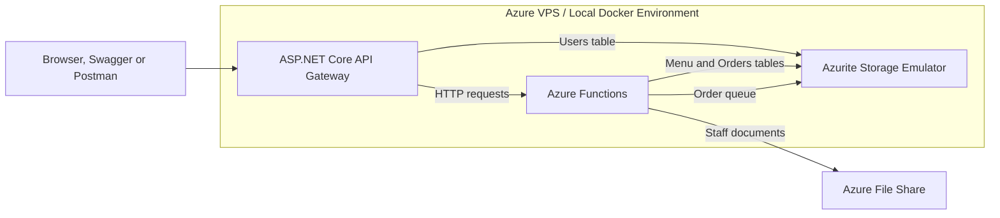

# CoffeeNChill Canteen Management System — CLDV6212 POE

## Overview

CoffeeNChill is a cloud-based canteen management system developed for the CLDV6212 Portfolio of Evidence.

The project was completed in three parts:

- **Part 1:** Azure Functions, Azure Table Storage and Azure File Share
- **Part 2:** Azure Queue Storage and queue-triggered order processing
- **Part 3:** ASP.NET Core API Gateway, JWT authentication, role-based authorization, Docker deployment and CI/CD

The system allows users to:

- Register and log in securely
- View and manage menu items
- Submit orders for asynchronous processing
- Track and update order statuses
- Upload and retrieve staff documents
- Access functionality according to their assigned role

---

## Contributors

| Contributor | Student Number | Responsibility |
|-------------|----------------|----------------|
| Douglass Duncan | ST10473980 | Account registration, password hashing, JWT authentication and role-based authorization |
| Neha Heeralal | ST10478910 | API Gateway, forwarding controllers, Swagger and exception handling |
| Tahir Ismail | ST10471483 | Docker, Azure VPS deployment, automated testing and CI/CD |

---

## Video Walkthrough

The following video demonstrates registration, login, JWT generation and role-based authorization:

[Watch the CoffeeNChill authentication demonstration on YouTube](https://youtu.be/Su1Gke0h5xI)

---

## Repository Structure

| Path | Description |
|------|-------------|
| `CoffeeNChill.Functions/` | Azure Functions project used by Parts 1 and 2 |
| `CoffeeNChill.ApiGateway/` | ASP.NET Core API Gateway used by Part 3 |
| `CoffeeNChill.ApiGateway/Controllers/` | Authentication and gateway controllers |
| `CoffeeNChill.ApiGateway/Services/` | Authentication and storage services |
| `CoffeeNChill.ApiGateway/DTOs/` | Request and response models |
| `CoffeeNChill.ApiGateway/Models/` | Azure Table Storage entity models |
| `docs/postman/` | Postman collections used for API testing |
| `docs/images/` | Screenshots and supporting evidence |
| `docker-compose.yml` | Container orchestration configuration |
| `.env.example` | Template for required environment variables |
| `.github/workflows/deploy.yml` | GitHub Actions CI/CD pipeline |
| `test-gateway.ps1` | Automated end-to-end API tests |

---

## System Architecture



The API Gateway is the public entry point to the application. It validates JWTs, checks user roles and forwards approved requests to the appropriate Azure Function.

---

# Part 1 — Menu and Document APIs

Part 1 uses .NET 8 isolated Azure Functions to expose menu-management and document-management endpoints.

## Menu API

Menu items are stored in Azure Table Storage.

The Menu API supports:

- Creating menu items
- Retrieving all menu items
- Retrieving one item by category and SKU
- Filtering menu items by category
- Updating menu items
- Deleting menu items

## Document API

Staff documents are stored in an Azure File Share.

The Document API supports:

- Uploading documents
- Listing stored documents
- Downloading documents

## Part 1 Storage

| Storage service | Purpose |
|-----------------|---------|
| Azure Table Storage | Stores menu items |
| Azure File Share | Stores staff documents |
| Azurite | Emulates Azure storage during local development |

---

# Part 2 — Order Queue Processing

Part 2 implements asynchronous order processing using Azure Queue Storage.

When an order is submitted:

1. The HTTP-triggered function validates the order.
2. Each supplied SKU is checked against the menu.
3. The total price is calculated using the stored menu prices.
4. The order is added to the `order-processing-queue`.
5. A queue-triggered function receives the message.
6. The processed order is saved in the `Orders` table.

## Order Lifecycle

Orders move through the following statuses:

```text
Received → Preparing → Ready → Collected
```

Failed queue messages are retried and can be moved to a poison queue when they cannot be processed successfully.

## Order Storage

| Storage resource | Purpose |
|------------------|---------|
| `order-processing-queue` | Holds new order messages |
| `Orders` table | Stores processed orders and their statuses |
| Poison queue | Holds messages that repeatedly fail |

---

# Part 3 — API Gateway

The `CoffeeNChill.ApiGateway` project is an ASP.NET Core Web API that acts as the public entry point to the system.

Clients communicate with the Gateway instead of calling the Azure Functions directly.

The Gateway is responsible for:

- Providing a single public API
- Registering and authenticating users
- Generating and validating JWTs
- Applying role-based authorization
- Forwarding approved requests to Azure Functions
- Providing Swagger/OpenAPI documentation
- Handling unexpected errors consistently

---

## Part 3 Role 1 — Gateway and Forwarding Controllers

**Author:** Neha Heeralal — ST10478910

The Gateway controllers use `IHttpClientFactory` to forward requests to the Azure Functions API.

### Role 1 Components

| File | Purpose |
|------|---------|
| `Program.cs` | Registers controllers, Swagger, HttpClient and middleware |
| `Controllers/MenuController.cs` | Forwards menu requests |
| `Controllers/OrdersController.cs` | Forwards order requests |
| `Controllers/DocumentsController.cs` | Forwards document requests |
| `Middleware/GlobalExceptionHandlingMiddleware.cs` | Handles unexpected exceptions |
| `DTOs/MenuItemRequestDto.cs` | Represents menu creation and update requests |

### Gateway Endpoints

| Method | Gateway route | Purpose |
|--------|---------------|---------|
| `POST` | `/api/auth/register` | Register an account |
| `POST` | `/api/auth/login` | Log in and generate a JWT |
| `GET` | `/api/health` | Check API health |
| `GET` | `/api/menu` | Retrieve all menu items |
| `GET` | `/api/menu/{category}/{sku}` | Retrieve one menu item |
| `GET` | `/api/categories/{category}` | Retrieve menu items by category |
| `POST` | `/api/menu` | Create a menu item |
| `PUT` | `/api/menu/{category}/{sku}` | Update a menu item |
| `DELETE` | `/api/menu/{category}/{sku}` | Delete a menu item |
| `POST` | `/api/orders/queue` | Submit an order |
| `GET` | `/api/orders` | Retrieve all orders |
| `GET` | `/api/orders/{orderId}` | Retrieve one order |
| `PUT` | `/api/orders/status` | Advance an order status |
| `PUT` | `/api/orders/{orderId}/status` | Set a specific order status |
| `POST` | `/api/documents/upload` | Upload a staff document |
| `GET` | `/api/documents` | List staff documents |
| `GET` | `/api/documents/download/{fileName}` | Download a staff document |

### Global Exception Handling

`GlobalExceptionHandlingMiddleware` catches unhandled exceptions and returns a consistent JSON response:

```json
{
  "error": "An unexpected error occurred.",
  "path": "/api/example",
  "method": "GET",
  "traceId": "request-trace-id"
}
```

Raw stack traces are not returned to clients.

---

## Part 3 Role 2 — Authentication and Authorization

**Author:** Douglass Duncan — ST10473980

Role 2 provides:

- Account registration
- Registration validation
- Secure password hashing
- Login using a username or email address
- JWT generation
- JWT validation
- Role-based authorization

### Authentication Components

| File | Purpose |
|------|---------|
| `Controllers/AuthController.cs` | Provides registration and login endpoints |
| `Services/AuthService.cs` | Stores users, retrieves accounts and generates JWTs |
| `Models/UserItem.cs` | Represents an account in Azure Table Storage |
| `DTOs/RegisterRequest.cs` | Validates registration data |
| `DTOs/LoginRequest.cs` | Validates login data |
| `DTOs/AuthResponse.cs` | Returns a JWT and its expiration date |
| `Program.cs` | Configures password hashing, JWT validation and authorization |

### Registration

Registration requires:

- Name
- Surname
- Email address
- Username
- Password
- Password confirmation
- Role

The registration DTO validates the supplied information using data annotations.

Passwords must:

- Contain at least eight characters
- Contain an uppercase letter
- Contain a lowercase letter
- Contain a number
- Contain a special character

Passwords are hashed using ASP.NET Core's `PasswordHasher<UserItem>`. The original password is never stored.

### Users Table

Accounts are stored in the Azure Table Storage `Users` table.

| Property | Stored value |
|----------|--------------|
| `PartitionKey` | Role: `Admin`, `Staff` or `Customer` |
| `RowKey` | Normalized email address |
| `Name` | User’s name |
| `Surname` | User’s surname |
| `Username` | Normalized username |
| `PasswordHash` | Hashed password |
| `CreatedDate` | Account creation date |

### Login

Users can log in using either their email address or username.

The login process:

1. Searches for the account using the supplied identifier.
2. Verifies the supplied password against the stored hash.
3. Generates a signed JWT when verification succeeds.
4. Returns the token and its expiration date.

### JWT Claims

The generated JWT contains:

- Subject identifier
- Unique token identifier
- Username
- Email address
- Full name
- Role
- Issuer
- Audience
- Expiration date

Tokens are signed using HMAC SHA-256.

### Authorization Attributes

The following ASP.NET Core attributes protect the endpoints:

```csharp
[AllowAnonymous]
```

Allows access without a token. This is used for registration and login.

```csharp
[Authorize]
```

Requires a valid JWT.

```csharp
[Authorize(Roles = "Admin,Staff")]
```

Requires a valid JWT containing an approved role.

### Authorization Rules

| Operation | Customer | Staff | Admin |
|-----------|----------|-------|-------|
| Register and log in | Yes | Yes | Yes |
| View the menu | Yes | Yes | Yes |
| Queue an order | Yes | Yes | Yes |
| Create menu items | No | Yes | Yes |
| Update menu items | No | Yes | Yes |
| Delete menu items | No | According to final policy | Yes |
| View all orders | No | Yes | Yes |
| Update order statuses | No | Yes | Yes |
| Manage staff documents | No | Yes | Yes |

### HTTP Authentication Responses

| Status | Meaning |
|--------|---------|
| `200 OK` | Login or request succeeded |
| `201 Created` | Account was registered |
| `400 Bad Request` | Supplied information was invalid |
| `401 Unauthorized` | No valid JWT or incorrect login credentials |
| `403 Forbidden` | User is authenticated but does not have the required role |
| `409 Conflict` | Account already exists |

### Authentication Demonstration

The authentication demonstration includes:

- Registering Customer, Staff and Admin accounts
- Confirming that passwords are hashed
- Logging in using an email address
- Logging in using a username
- Generating a JWT
- Testing without a token
- Testing Customer authorization
- Testing Staff authorization
- Testing Admin authorization
- Demonstrating `401 Unauthorized`
- Demonstrating `403 Forbidden`

[Watch the authentication and authorization demonstration](https://youtu.be/Su1Gke0h5xI)

---

## Part 3 Role 3 — Docker, VPS Deployment and CI/CD

**Author:** Tahir Ismail — ST10471483

The complete CoffeeNChill system is deployed to an Azure Ubuntu VPS using Docker Compose.

### Deployment Deliverables

| Deliverable | Location |
|-------------|----------|
| Live Swagger UI | `http://40.127.11.155:5000/swagger` |
| API Gateway image | [tahirismail/coffeenchill-gateway](https://hub.docker.com/r/tahirismail/coffeenchill-gateway) |
| Azure Functions image | [tahirismail/coffeenchill-functions](https://hub.docker.com/r/tahirismail/coffeenchill-functions) |
| Gateway Dockerfile | `CoffeeNChill.ApiGateway/Dockerfile` |
| Container orchestration | `docker-compose.yml` |
| Environment template | `.env.example` |
| CI/CD pipeline | `.github/workflows/deploy.yml` |
| Automated tests | `test-gateway.ps1` |

### VPS Configuration

| Setting | Value |
|---------|-------|
| Provider | Microsoft Azure |
| Region | South Africa North |
| Operating system | Ubuntu Server 24.04 LTS |
| Public port | `5000` |
| SSH port | `22` |
| Container platform | Docker Engine and Docker Compose |

Only the API Gateway is publicly accessible. The Azure Functions and Azurite services remain inside the private Docker network.

### Docker Services

| Service | Purpose |
|---------|---------|
| `gateway` | Public API Gateway, Swagger and JWT authorization |
| `functions` | Azure Functions backend |
| `azurite` | Local Table, Queue and Blob storage |

Azurite uses a named volume so that users, menu items and orders survive container restarts.

### CI/CD Pipeline

The GitHub Actions workflow runs when changes are pushed to `main`.

The pipeline:

1. Restores and builds the .NET solution.
2. Runs automated tests.
3. Builds the Docker images.
4. Publishes the images to Docker Hub.
5. Connects to the VPS using SSH.
6. Pulls the new images.
7. Restarts the Docker Compose stack.
8. Runs end-to-end tests against the deployment.

A failed build or failed test prevents an unsuccessful version from being deployed.

---

# Configuration

## Local configuration

The API Gateway uses the following settings:

```json
{
  "Functions": {
    "BaseUrl": "http://localhost:7071/api"
  },
  "Storage": {
    "ConnectionString": "UseDevelopmentStorage=true"
  },
  "JwtSettings": {
    "Issuer": "CoffeeNChill.ApiGateway",
    "Audience": "CoffeeNChill.Client",
    "Key": "LOCAL-DEVELOPMENT-KEY-AT-LEAST-32-CHARACTERS",
    "ExpiryMinutes": 60
  }
}
```

Do not commit real production keys or connection strings.

## Docker environment variables

ASP.NET Core uses double underscores to represent nested configuration sections.

| Environment variable | Application setting |
|----------------------|---------------------|
| `Functions__BaseUrl` | `Functions:BaseUrl` |
| `Storage__ConnectionString` | `Storage:ConnectionString` |
| `JwtSettings__Key` | `JwtSettings:Key` |
| `JwtSettings__Issuer` | `JwtSettings:Issuer` |
| `JwtSettings__Audience` | `JwtSettings:Audience` |
| `JwtSettings__ExpiryMinutes` | `JwtSettings:ExpiryMinutes` |

Production secrets are stored in a `.env` file that is excluded from Git.

Example:

```text
FileShareStorage=<Azure File Share connection string>
JWT_KEY=<secure random JWT signing key>
IMAGE_TAG=v3.1
```

---

# Running the Project Locally

## Prerequisites

Install:

- Git
- .NET 8 SDK
- Azure Functions Core Tools
- Azurite or Docker Desktop
- JetBrains Rider, Visual Studio or Visual Studio Code
- Postman Desktop

## Clone the repository

```bash
git clone https://github.com/Douglass-Duncan-ST10473980/CLDV6212-FinalPoe.git
cd CLDV6212-FinalPoe
```

## Option 1 — Run without Docker Compose

Start Azurite:

```bash
azurite
```

Start the Azure Functions project:

```bash
cd CoffeeNChill.Functions
func start
```

In a second terminal, start the Gateway:

```bash
cd CoffeeNChill.ApiGateway
dotnet run
```

Open Swagger:

```text
http://localhost:5000/swagger
```

## Option 2 — Run using Docker Compose

Create the local environment file:

```bash
cp .env.example .env
```

Add the required values to `.env`, then run:

```bash
docker compose pull
docker compose up -d
docker compose ps
```

Open Swagger:

```text
http://localhost:5000/swagger
```

Stop the containers with:

```bash
docker compose down
```

---

# Testing Authentication in Swagger

## Register a Customer

```json
{
  "name": "Cameron",
  "surname": "Customer",
  "email": "customer@coffeenchill.test",
  "username": "customer.demo",
  "password": "Customer@123",
  "confirmPassword": "Customer@123",
  "role": "Customer"
}
```

## Register a Staff User

```json
{
  "name": "Stella",
  "surname": "Staff",
  "email": "staff@coffeenchill.test",
  "username": "staff.demo",
  "password": "StaffDemo@123",
  "confirmPassword": "StaffDemo@123",
  "role": "Staff"
}
```

## Register an Administrator

```json
{
  "name": "Adam",
  "surname": "Administrator",
  "email": "admin@coffeenchill.test",
  "username": "admin.demo",
  "password": "AdminDemo@123",
  "confirmPassword": "AdminDemo@123",
  "role": "Admin"
}
```

## Log in

```json
{
  "usernameOrEmail": "customer@coffeenchill.test",
  "password": "Customer@123"
}
```

Copy the token returned by the API.

Select **Authorize** in Swagger and enter:

```text
Bearer <your-token>
```

After authorization, test the endpoints permitted for that user’s role.

---

# Automated Testing

Run the PowerShell end-to-end tests locally:

```powershell
powershell -ExecutionPolicy Bypass -File .\test-gateway.ps1
```

Run them against the VPS:

```powershell
powershell -ExecutionPolicy Bypass -File .\test-gateway.ps1 `
  -BaseUrl http://40.127.11.155:5000
```

The automated suite tests:

- Requests without tokens
- Registration validation
- Duplicate accounts
- Correct and incorrect passwords
- Customer authorization
- Staff authorization
- Menu management
- Order processing
- Document management
- Test-data cleanup

The recorded live result was:

```text
39 passed, 0 failed
```

---

# Postman Testing

Import:

```text
docs/postman/CoffeeNChill Part 3 - API Gateway (JWT and Roles).postman_collection.json
```

The collection tests:

- Registration
- Login
- JWT authorization
- Menu endpoints
- Order endpoints
- Document endpoints
- Invalid requests
- Unauthorized requests
- Forbidden requests

For document upload testing, select the supplied test PDF in the Postman request before running the collection.

---

# Swagger

Swagger is available at:

- **Local:** `http://localhost:5000/swagger`
- **VPS:** `http://40.127.11.155:5000/swagger`

Swagger remains enabled in production so the deployed API can be demonstrated and assessed.

---

# Security

The project includes the following security measures:

- Password hashing
- JWT signature validation
- JWT issuer validation
- JWT audience validation
- JWT expiration validation
- Role-based authorization
- Non-root Docker containers
- Private Docker networking
- Environment-based production secrets
- Restricted VPS inbound ports
- Global exception handling
- No raw stack traces returned to clients

Production secrets must never be committed to the repository.

The following files should remain excluded through `.gitignore`:

```text
.env
appsettings.Production.json
*.user
```

---

# Common Response Codes

| Code | Meaning |
|------|---------|
| `200 OK` | Request completed successfully |
| `201 Created` | Resource was created |
| `202 Accepted` | Order was accepted for queue processing |
| `204 No Content` | Resource was deleted successfully |
| `400 Bad Request` | Validation or request data was invalid |
| `401 Unauthorized` | Authentication failed or no valid token was supplied |
| `403 Forbidden` | Authenticated user lacks the required role |
| `404 Not Found` | Requested resource does not exist |
| `409 Conflict` | Account or resource already exists |
| `500 Internal Server Error` | Unexpected server error |

---

# Useful VPS Commands

Check the containers:

```bash
docker compose ps
```

View Gateway logs:

```bash
docker compose logs gateway --tail 50
```

View Functions logs:

```bash
docker compose logs functions --tail 50
```

Pull and restart the deployment:

```bash
docker compose pull
docker compose up -d
```

Test whether Swagger is responding:

```bash
curl -s http://localhost:5000/swagger/v1/swagger.json \
  -o /dev/null \
  -w "%{http_code}\n"
```

---

# Troubleshooting

| Problem | Possible solution |
|---------|-------------------|
| `JwtSettings:Issuer is missing` | Check the `JwtSettings` section or Docker environment variables |
| `Storage:ConnectionString is missing` | Add the storage connection string to the configuration |
| `TableNotFound` | Confirm that Azurite is running and ensure the table is created before access |
| `401 Unauthorized` | Log in again and supply a valid, unexpired JWT |
| `403 Forbidden` | Use an account containing the required role |
| Swagger does not show Authorize | Confirm that the Bearer security definition is registered |
| Functions cannot be reached | Check `Functions:BaseUrl` and confirm the Functions host is running |
| Invalid JWT signature | Ensure token generation and validation use the same JWT key |
| Containers cannot communicate | Use Docker service names instead of `localhost` |

---

# Final Result

The completed CoffeeNChill system demonstrates:

- Serverless Azure Functions
- Azure Table Storage
- Azure Queue Storage
- Azure File Share
- Asynchronous order processing
- ASP.NET Core API Gateway development
- Secure password hashing
- JWT authentication
- Role-based authorization
- Swagger and Postman testing
- Docker containerization
- Azure VPS deployment
- Automated CI/CD

The Gateway provides one secured public entry point while the Azure Functions and storage services remain behind the application boundary.
